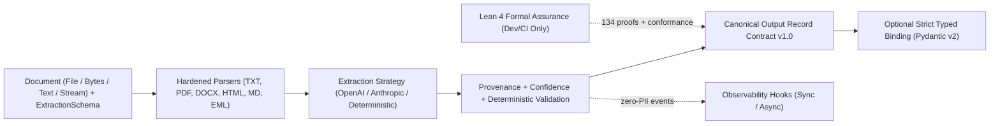

# structa-maestro

[](https://github.com/ivnmoreno/structa-maestro/actions/workflows/ci.yml)
[](https://github.com/ivnmoreno/structa-maestro/actions/workflows/formal-assurance.yml)
[](https://github.com/ivnmoreno/structa-maestro/actions/workflows/security.yml)
[](https://github.com/ivnmoreno/structa-maestro/actions/workflows/evaluation.yml)
[](https://www.python.org/downloads/)
[](LICENSE)
[](https://github.com/astral-sh/ruff)
[](https://mypy-lang.org/)
[](docs/formal-assurance.md)
[](https://commitizen-tools.github.io/commitizen/)

**Structured Data Extraction Engine** — a reusable, stateless Python library (`structa_maestro`) with a minimal thin CLI (`structa-maestro`) that transforms unstructured documents (`TXT`, text-based `PDF`, `DOCX`, `HTML`, `Markdown`, and `EML`) into **validated, schema-conforming, provenance-backed canonical records** using only four pure-Python runtime dependencies (`pydantic`, `pypdf`, `python-docx`, `httpx`).

[Quick Start](#quick-usage-python-library) • [Input Formats](#supported-input-formats) • [Strategies](#built-in-extraction-strategies) • [CLI](#thin-cli-extract--extract-batch) • [Examples](#runnable-offline-examples) • [Formal Assurance](#formal-assurance-layer-lean-4--dev--ci-only) • [Docs](#further-documentation)

---

## What It Solves (and What It Does Not)

Unstructured business documents (invoices, contracts, employment records, applications, emails, reports) frequently need to be converted into reliable structured data. Ad-hoc LLM JSON generation blurs extracted values, schema validity, source evidence, and operational completion into a single fragile blob.

`structa-maestro` treats extraction as a staged data-processing operation with **five strictly separated quality dimensions**:

| Dimension | Question Answered | Epistemic Guarantee |
| --- | --- | --- |
| **Extracted value** | What value was identified? | Strictly distinguishes `missing`, explicit `null`, and `""` (zero silent coercion) |
| **Confidence** | How reliable does the strategy assess this value? | Bounded on declared scale (`0-1`), `calibrated: false` by default; opt-in empirical `CalibrationModel` sets `calibrated: true` only when warranted |
| **Provenance** | What source excerpt & location support it? | Verified verbatim against `PreparedDocument`; unlocated quotes marked `unverified` |
| **Validation** | Does the record satisfy schema & cross-field rules? | Deterministic non-coercing validator (`valid` / `invalid` / `not_validated`) |
| **Processing status** | Did the extraction pipeline complete? | `completed` / `partial` / `failed`, strictly independent of schema validity |



> [!IMPORTANT]
> **Explicit Scope Boundaries**: `structa-maestro` is a focused structured extraction engine — **not** an OCR engine (image-only PDFs report `no_extractable_text`), **not** a RAG/vector/embedding search platform, and **not** a database-backed workflow server or multi-provider router.

---

## Supported Input Formats

Format detection inspects actual content signatures (magic bytes, binary checks, and archive contents) rather than blindly trusting filename extensions or media-type hints:

| Format | Media Type | Extensions | Provenance Locations | Built-In Hardening (Zero Extra Deps) |
| --- | --- | --- | --- | --- |
| **TXT** | `text/plain` | `.txt` | `line_start`, `line_end`, `char_*` | UTF-8 / UTF-8 BOM / UTF-16 / Latin-1 decoding, `max_file_bytes` |
| **PDF** | `application/pdf` | `.pdf` | `page`, `char_*` | Magic-byte validation, `max_pages` (default 200) & text caps |
| **DOCX** | `application/vnd.openxmlformats-officedocument.wordprocessingml.document` | `.docx` | `paragraph`, `section`, `char_*` | Pre-open ZIP-bomb inspection (`max_decompressed_bytes`) |
| **HTML** | `text/html` | `.html`, `.htm` | `section`, `paragraph`, `char_*` | Strips `<script>`/`<style>`/`<noscript>`/`<template>`/comments, incremental entity-expansion guard, zero network fetches |
| **Markdown** | `text/markdown` | `.md`, `.markdown` | `section`, `paragraph`, `line_*`, `char_*` | ATX/Setext heading tracking (ignoring `#` in fenced code blocks) |
| **EML** | `message/rfc822` | `.eml` | `section`, `paragraph`, `char_*` | Normalized `Headers` + `text/plain`/HTML body, 128-part / 16-depth MIME-bomb caps, safe attachment skipping (`attachments_skipped`) |

All formats work seamlessly from files or in-memory via `DocumentInput.from_bytes(...)`, `from_text(...)`, `from_stream(...)`, and `from_path(...)` with **zero temporary files written to disk**.

---

## Built-In Extraction Strategies

All strategies sit behind a strict **Strategy-to-Contract Firewall** (`StrategyOutput` → `ResultBuilder` → `ExtractionResult`), ensuring provider wire formats (`choices`, `tool_use`, `usage`, etc.) never leak into Contract `v1.0`:

| Strategy | Mode | Wire Protocol | Structured Output & Hardening |
| --- | --- | --- | --- |
| `OpenAICompatibleLLMStrategy` / `AsyncOpenAICompatibleLLMStrategy` | Sync / Async | OpenAI Chat Completions (`/v1/chat/completions`, vLLM, Ollama, LiteLLM, proxies) | Strict `json_schema` + single-step JSON fallback, bounded retries (`Retry-After`, deadlines), `InputBudgetPolicy`, nonce + delimiter neutralization, token telemetry |
| `AnthropicLLMStrategy` / `AsyncAnthropicLLMStrategy` | Sync / Async | Native Anthropic Messages API (`/v1/messages`) | Forced `tool_use` (`emit_extraction_result`) + single-step JSON-text fallback, `429`/`529` overloaded retries, `x-api-key` scrubbing, `InputBudgetPolicy`, token telemetry |
| `DeterministicTestStrategy` / `AsyncDeterministicTestStrategy` | Sync / Async | In-process callable / static output | 100% offline deterministic testing, contract verification, and golden evaluation |

---

## Installation

Requires **Python 3.11, 3.12, or 3.13**.

```bash
pip install structa-maestro
```

For local development with testing, linting, and security tooling:

```bash
python3 -m venv .venv
source .venv/bin/activate
pip install -e ".[dev]"
```

> [!NOTE]
> Installing `structa-maestro` requires **zero Lean tooling** and installs only four pure-Python packages (`pydantic`, `pypdf`, `python-docx`, `httpx`).

---

## Quick Usage (Python Library)

```python
import os
from structa_maestro import (
    ExtractionSchema,
    OpenAICompatibleLLMStrategy,
    extract,
)

schema = ExtractionSchema.from_dict(
    {
        "schema_id": "invoice-schema",
        "schema_version": "1.0",
        "cardinality": "single",
        "fields": {
            "invoice_number": {"type": "string", "required": True, "pattern": r"^INV-\d{4}-\d+$"},
            "vendor_name": {"type": "string", "required": True},
            "issue_date": {"type": "date", "required": True},
            "total_amount": {"type": "decimal", "required": True, "min_value": 0},
            "currency": {
                "type": "string",
                "required": True,
                "allowed_values": ["USD", "EUR", "GBP"],
            },
            "notes": {"type": "string", "required": False, "nullable": True},
        },
    }
)

strategy = OpenAICompatibleLLMStrategy(
    model="gpt-4o-mini",
    api_key=os.environ["STRUCTA_MAESTRO_API_KEY"],
)

result = extract("invoice.pdf", schema, strategy=strategy, document_id="doc-001")
print(result.status, result.validation.status)
print(result.to_json(indent=2))
```

### Pydantic v2 Schemas, JSON Export & Strict Typed Binding

Define your schema once as a Pydantic v2 `BaseModel`, export it losslessly for CLI use, and opt into strict non-coercing binding after canonical extraction:

```python
from datetime import date
from decimal import Decimal
from enum import StrEnum
from pydantic import BaseModel, Field
from structa_maestro import (
    ExtractionSchema,
    RecordBindingError,
    bind_records,
    extract,
)


class Currency(StrEnum):
    USD = "USD"
    EUR = "EUR"


class Invoice(BaseModel):
    invoice_number: str = Field(pattern=r"^INV-\d{4}-\d+$")
    vendor_name: str = Field(min_length=1)
    issue_date: date
    total_amount: Decimal = Field(ge=0)
    currency: Currency = Currency.USD
    notes: str | None = None


schema = ExtractionSchema.from_pydantic(Invoice, schema_id="invoice-schema")
result = extract("invoice.pdf", schema, strategy=strategy)

try:
    invoices: list[Invoice] = bind_records(result, Invoice)
except RecordBindingError as exc:
    # Failed/invalid results are refused safely (no raw extracted values leaked in exc)
    print(result.status, result.validation.status, exc)
```

> [!TIP]
> For multi-record `partial` extractions, pass `only_valid=True` to `bind_records(result, Invoice, only_valid=True)` to materialize only `completed` + `valid` records while preserving full provenance, confidence, and diagnostics on `ExtractionResult`.

### Native Asyncio Extraction (`aextract`, `aextract_batch`, FastAPI)

Use `AsyncOpenAICompatibleLLMStrategy` or `AsyncAnthropicLLMStrategy` (backed by `httpx.AsyncClient` and non-blocking `asyncio.sleep` retries) with `aextract(...)` and `aextract_batch(...)`:

```python
import os
from structa_maestro import (
    AsyncAnthropicLLMStrategy,
    BatchOptions,
    DocumentInput,
    InMemoryTelemetryObserver,
    aextract,
    aextract_batch,
)

telemetry = InMemoryTelemetryObserver()

# Pooled client via `async with` (or pass a shared FastAPI lifespan `http_client=httpx.AsyncClient(...)`)
async with AsyncAnthropicLLMStrategy(
    model="claude-sonnet-4-5",
    api_key=os.environ["ANTHROPIC_API_KEY"],
) as strategy:
    result = await aextract(
        DocumentInput.from_bytes(upload_bytes, filename="invoice.pdf"),
        schema,
        strategy=strategy,
        observers=[telemetry],
    )
    batch = await aextract_batch(
        [doc_a, doc_b, doc_c],
        schema,
        strategy=strategy,
        options=BatchOptions(max_workers=4),
        observers=[telemetry],
    )

print(telemetry.summary().to_json(indent=2))
```

- Blocking document parsing and synchronous strategies are offloaded via `asyncio.to_thread`, and external `asyncio.CancelledError` propagates cleanly while cancelling in-flight batch tasks.
- Observer callbacks (`InMemoryTelemetryObserver`, `StructuredLoggingObserver`, or custom `ExtractionObserver` / `AsyncExtractionObserver` adapters for OpenTelemetry/Prometheus) are strictly fault-isolated and carry zero raw text, extracted values, host paths, or credentials.

---

## Thin CLI (`extract` & `extract-batch`)

```bash
export STRUCTA_MAESTRO_API_KEY="your-api-key"

# Single document -> Canonical Output Record Contract v1.0 JSON (OpenAI default, or --provider anthropic)
structa-maestro extract invoice.pdf --schema invoice_schema.json --pretty
ANTHROPIC_API_KEY="your-key" structa-maestro extract invoice.pdf --schema invoice_schema.json --provider anthropic --pretty

# Pipe binary or text document via stdin ('-') without temporary files
cat invoice.pdf | structa-maestro extract - --schema invoice_schema.json --filename invoice.pdf

# Folder / multi-file batch -> Contract v1.0 JSON Lines (JSONL) + optional summary & telemetry
structa-maestro extract-batch ./invoices/ --schema invoice_schema.json \
  --recursive --max-workers 4 --output results.jsonl \
  --summary-json summary.json --telemetry-json telemetry.json
```

- **Exit codes**: `0` (all `completed` + `valid`), `2` (any `partial`/`failed`/`invalid` canonical result or early `--fail-fast` stop), `1` (CLI usage, empty discovery, schema, or configuration error).
- Supports reliability flags (`--provider`, `--max-tokens`, `--structured-output-mode`, `--max-retries`, `--max-input-chars`, `--overflow-policy`), `--calibrator <artifact.json>`, and `--telemetry-json <path>` while keeping `stdout` strictly Contract `v1.0`.
- Also provides offline human-review subcommands: `structa-maestro review-plan <result.json>` (exit `0` clean / `2` needs review) and `structa-maestro apply-review <result.json> --schema <schema.json> --decisions <decisions.json> [--audit-json <audit.json>]`.

---

## Runnable Offline Examples

All 14 scripts under [examples/](examples/) execute completely offline (zero API keys required) and are verified continuously in CI:

| Example Script | Capability Demonstrated |
| --- | --- |
| [basic_invoice_extraction.py](examples/basic_invoice_extraction.py) | End-to-end single-record extraction, provenance, confidence, and Contract `v1.0` JSON |
| [multi_record_extraction.py](examples/multi_record_extraction.py) | Multi-record extraction (`cardinality="multiple"`) with per-record validation |
| [custom_strategy_example.py](examples/custom_strategy_example.py) | Implementing a custom `ExtractionStrategy` behind the Strategy-to-Contract Firewall |
| [hardened_llm_strategy_example.py](examples/hardened_llm_strategy_example.py) | Strict `json_schema`, fallback, bounded retries, `InputBudgetPolicy`, and delimiter neutralization |
| [anthropic_strategy_example.py](examples/anthropic_strategy_example.py) | Sync & async `AnthropicLLMStrategy` forced `tool_use` + token telemetry over `httpx.MockTransport` |
| [cross_field_validation_example.py](examples/cross_field_validation_example.py) | Declarative comparison, exact `Decimal` arithmetic balance, conditional & group rules |
| [batch_extraction_example.py](examples/batch_extraction_example.py) | Stateless concurrent `extract_batch(...)`, `fail_fast`, `BatchSummary`, and JSONL export |
| [in_memory_extraction_example.py](examples/in_memory_extraction_example.py) | Zero-temp-file `DocumentInput.from_bytes`, `from_text`, and `from_stream` extraction |
| [pydantic_schema_example.py](examples/pydantic_schema_example.py) | `ExtractionSchema.from_pydantic`, JSON export, and strict `bind_record` / `bind_records` |
| [async_extraction_example.py](examples/async_extraction_example.py) | Native asyncio `aextract`, `aextract_batch`, pooled `async with`, and concurrency bounds |
| [observability_telemetry_example.py](examples/observability_telemetry_example.py) | `InMemoryTelemetryObserver`, `StructuredLoggingObserver`, stage timings, and token rollups |
| [multiformat_extraction_example.py](examples/multiformat_extraction_example.py) | Consistent extraction & provenance across HTML, Markdown, and RFC 5322 EML documents |
| [confidence_calibration_example.py](examples/confidence_calibration_example.py) | Zero-dependency empirical calibration (`fit_calibrator`), ECE/Brier reduction, artifact persistence, and `calibrated: false` vs. `true` |
| [human_review_workflow_example.py](examples/human_review_workflow_example.py) | Stateless `plan_review` triage, immutable `apply_review` corrections + re-validation, privacy-safe `ReviewAudit`, and `bind_records` |

---

## Canonical Output Record Contract (`1.0`)

Every extraction returns an immutable `ExtractionResult` supporting lossless round-trip serialization (`ExtractionResult.from_json(result.to_json()) == result`):

- `contract_version`: `"1.0"`
- `extraction_id`: unique UUIDv4 per operation
- `status`: `"completed" | "partial" | "failed"`
- `source`: `{ "document_id", "filename", "media_type" }` (basename only — local host directories are never leaked)
- `schema`: `{ "schema_id", "schema_version" }`
- `records`: ordered list of `ExtractedRecord` (`record_id`, `status`, `fields`, `validation`, `errors`, `warnings`)
- `validation`: top-level deterministic `ValidationOutcome` (`"valid" | "invalid" | "not_validated"`, `errors`)
- `errors` / `warnings`: structured, privacy-safe `DiagnosticIssue` lists

---

## Current Limitations

> [!WARNING]
> - **Confidence calibration requires domain-representative data**: By default (`calibrator=None`), confidence scores report `"calibrated": false` and MUST NOT be interpreted as statistical probabilities. Even when an offline empirical `CalibrationModel` sets `"calibrated": true`, calibration reflects empirical accuracy on its fitting distribution only and never implies schema validity or factual truth.
> - **External model data transmission**: `OpenAICompatibleLLMStrategy`, `AsyncOpenAICompatibleLLMStrategy`, `AnthropicLLMStrategy`, and `AsyncAnthropicLLMStrategy` transmit prepared document text to the configured endpoint; review provider data-handling policies before processing confidential documents.

- **Intra-record validation scope**: Declarative cross-field and conditional validation rules operate within each extracted record (including nested objects and line-item arrays); cross-document validation remains out of scope.
- **Text-only extraction**: Scanned PDFs and embedded images are not OCR-processed.

---

## Golden Evaluation & Regression Suite

Contributors can run the repository-internal 50-case golden evaluation harness offline without external API keys (excluded from published wheels and sdists):

```bash
python -m evals validate-dataset
python -m evals run --strategy deterministic --baseline evals/baselines/deterministic_v2.0.0.json
```

See [docs/development.md](docs/development.md) for subset filtering, repeated-trial (`--trials`) distributions, differential strategy comparison (`python -m evals diff`), and on-demand live-model benchmarking.

---

## Formal Assurance Layer (Lean 4 — Dev & CI Only)

`formal/` contains an independent, zero-external-dependency **Lean 4** project (pinned via `formal/lean-toolchain`, excluded from Python wheels and sdists, with **zero runtime dependency** for `structa-maestro` consumers) that machine-checks **134 theorems** across **Canonical Output Record Contract v1.0** (46 theorems), **Schema Well-Formedness & Deterministic Validation Semantics** (32 theorems), **Declarative Cross-Field & Conditional Validation Rules** (30 theorems), and **Provenance Association, Source-Span Mapping & Full `ResultBuilder` Firewall Soundness** (26 theorems: span overlap/clamping/fallback, bounded excerpts, foreign-doc rejection, unlocated `UNVERIFIED`, `DIRECT` conflict downgrade, `record-NNN` uniqueness, `MISSING` sanitization, provenance fault isolation, validation-only warning propagation, and end-to-end `ValidExtractionResult` soundness), replayed from scratch via `Lean.Kernel.Environment.replay` and cross-checked against Python via a two-layer conformance suite:

```bash
cd formal && lake build && lake test
cd .. && STRUCTA_REQUIRE_LEAN_ORACLE=1 pytest tests/conformance/ -v
```

See [Formal Assurance Guide](docs/formal-assurance.md) for the 4-layer assurance diagram, complete assurance matrix, formal model scope, assumptions, and explicit non-goals.

---

## Further Documentation

- [Architecture](docs/architecture.md)
- [Formal Assurance Layer](docs/formal-assurance.md)
- [Public API & CLI Reference](docs/api.md)
- [Configuration & Security](docs/configuration.md)
- [Development & Quality Gates](docs/development.md)
- [Testing Strategy & CI Rules](docs/TESTING.md)
- [Contributing Guide](CONTRIBUTING.md)
- [Code of Conduct](CODE_OF_CONDUCT.md)
- [Security Policy](SECURITY.md)
- [Changelog](CHANGELOG.md)
