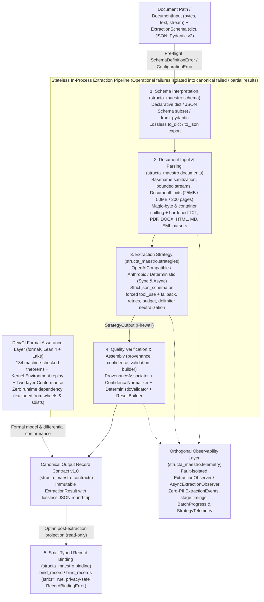

# Architecture — structa-maestro

`structa-maestro` (`structa_maestro`) is structured as a modular, stateless, staged extraction pipeline with explicit internal contracts and only four pure-Python runtime dependencies (`pydantic`, `pypdf`, `python-docx`, `httpx`).

## Processing Lifecycle

> [!IMPORTANT]
> **Strategy-to-Contract Firewall**: Extraction strategies return internal `StrategyOutput` DTOs (with optional `StrategyTelemetry`) and **never** construct `ExtractionResult` directly. Provider-specific wire fields (`choices`, `tool_use`, `usage`, `stop_reason`, `id`) cannot leak into public Contract `v1.0` outputs; normalized token and attempt counts flow exclusively to opt-in telemetry observers.

## Component Boundaries

| Stage / Layer | Package / Directory | Primary Responsibility | Failure Boundary |
| --- | --- | --- | --- |
| **1. Schema Interpretation** | `structa_maestro.schema` | Compile dict, JSON Schema subset, or Pydantic v2 `BaseModel` into immutable `ExtractionSchema` with intra-record `ValidationRule`s | Eager `SchemaDefinitionError` before work begins |
| **2. Document Input & Parsing** | `structa_maestro.documents` | Safe signature sniffing, bounded stream reading, zero-temp-file parsing (`TXT`, `PDF`, `DOCX`, `HTML`, `Markdown`, `EML`) into `PreparedDocument` + `DocumentSegment` map | Canonical `ExtractionResult(status="failed")` |
| **3. Extraction Strategies** | `structa_maestro.strategies` | Sync (`ExtractionStrategy`) & Async (`AsyncExtractionStrategy`) protocols; OpenAI-compatible, native Anthropic `/v1/messages`, and offline deterministic backends | Isolated into `StrategyOutput(failed/partial)` |
| **4. Quality & Assembly** | `provenance`, `confidence`, `validation`, `builder` | Quote verification & location mapping, honest confidence normalization & opt-in empirical calibration (`CalibrationModel`), non-coercing deterministic validation, and honest status assembly | Isolated warnings/errors (including calibrator fault fallback); never promotes `partial`/`failed` to `completed` |
| **5. Strict Typed Binding** | `structa_maestro.binding` | Optional post-extraction projection (`bind_record` / `bind_records`) using `strict=True` Pydantic v2 validation | Privacy-safe `RecordBindingError` (never leaks raw values) |
| **Observability (Orthogonal)** | `structa_maestro.telemetry` | Correlated, basename-sanitized, zero-PII lifecycle events, stage timings, live `BatchProgress`, and cumulative `StrategyTelemetry` | Observer `Exception`s isolated & scrubbed; `CancelledError` propagates |
| **Formal Assurance (Dev/CI)** | `formal/` + `tests/conformance/` | Lean 4 mathematical specification of Contract `v1.0`, Schema Well-Formedness, Deterministic Validation, Cross-Field Rules, Provenance Association & Full `ResultBuilder` Assembly (134 theorems, `Kernel.Environment.replay`, two-layer conformance) | CI & release gates; zero Python runtime dependency |

## Key Architectural Decisions

1. **Strategy-to-Contract Firewall**: Extraction strategies return internal `StrategyOutput` DTOs (with optional `StrategyTelemetry`) and never construct `ExtractionResult` directly. Provider-specific response fields (`choices`, `tool_use`, `usage`, `id`, etc.) cannot leak into public Contract `v1.0` outputs; normalized token/attempt counts flow exclusively to opt-in telemetry observers.
2. **Non-Coercing Deterministic Validation & Opt-In Binding**: Schema validation is implemented independently of Pydantic coercion so extracted values are never silently altered (e.g., `"42"` is not silently coerced to `42`; `""`, `None`, and `FieldPresence.MISSING` remain strictly distinct). Optional downstream typed binding (`bind_record`/`bind_records`) runs strictly *after* canonical assembly using `strict=True`, leaving provenance, confidence, and validation intact on `ExtractionResult`.
3. **Failure Reporting Boundary**: Caller definition errors (`SchemaDefinitionError`, `ConfigurationError`) raise immediately before work starts; all document, parsing, extraction, provenance, and validation failures return canonical `ExtractionResult` objects with `status="failed"` or `status="partial"`; observer callback `Exception`s are isolated and scrubbed so observability never degrades extraction reliability; opt-in typed binding rejects invalid/mismatched records with privacy-safe `RecordBindingError`.
4. **Proportional Dependencies**: Direct `httpx` (`Client` and `AsyncClient`) usage avoids vendor LLM SDK lock-in; strict schema compilation, bounded retries, `Retry-After` parsing, input budgeting, delimiter neutralization, cross-field validation, stateless in-process sync (`concurrent.futures`) and async (`asyncio` + `to_thread`) batch scheduling, in-memory bounded streaming, hardened HTML/Markdown/EML stdlib parsing, and privacy-safe telemetry/observers (`telemetry.py`) use Python's standard library; `ExtractionSchema.from_pydantic` and strict record binding reuse the existing `pydantic` dependency with zero new packages; `pypdf` and `python-docx` avoid native binary and AGPL licensing overhead; the thin CLI (`extract` and `extract-batch`) uses standard-library `argparse`.
5. **Dev/CI-Only Formal Assurance Isolation**: Lean 4 formal specifications and proofs live independently under `formal/` with zero external Lean dependencies, zero FFI/runtime services, and strict exclusion from published Python wheels and sdists. See [Formal Assurance Layer](formal-assurance.md) and [Formal Assurance Architectural Intent](formal-assurance-intent.md).
