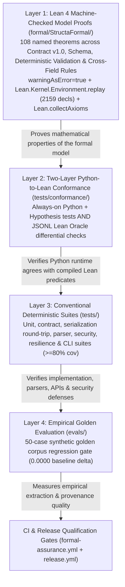

# Formal Assurance Layer (`formal/`)

`structa-maestro` includes an independent **Lean 4** formal specification and theorem-proving layer under `formal/` that formally specifies selected invariants of **Canonical Output Record Contract v1.0**, **Schema Well-Formedness** (`ExtractionSchema`, `FieldSpec`, `FieldConstraints`, `ExtractionCardinality`), **Deterministic Validation Semantics** (`DeterministicValidator`), and **Declarative Cross-Field & Conditional Validation Rules** (`ComparisonRule`, `ArithmeticRule`, `ConditionalPresenceRule`, `GroupPresenceRule`, `RuleSeverity`) and complements them with an independent two-layer Python-to-Lean conformance suite.

> [!IMPORTANT]
> **Architectural Principle**: Structa uses deterministic processing and empirical testing to establish observed implementation behavior, while formal verification establishes mathematical properties of explicitly defined domain models. Both contribute to assurance, and neither is misrepresented as proof of the factual correctness of extracted information.

---

## 1. Four-Layer Assurance Architecture



### Runtime Isolation Guarantees

- **Python remains the sole runtime language**: `structa_maestro` has **zero** Lean runtime dependencies, **zero** FFI bridges, and **zero** Lean background services.
- **Zero consumer impact**: Ordinary users installing `structa-maestro` from PyPI wheels or source distributions never need Lean or Lake installed; `formal/` is strictly excluded from both built wheels and source distributions (`sdist`).
- **Standalone Lake project**: `formal/` is pinned to `leanprover/lean4:v4.36.0` (`formal/lean-toolchain`) with **zero external Lean dependencies** (no Mathlib), strict `warningAsError = true` compilation, full kernel proof replay (`Lean.Kernel.Environment.replay`), and a programmatic `Lean.collectAxioms` theorem audit (`lake test`).
- **Contract v1.0 unchanged**: The formal layer faithfully mirrors the authoritative Python implementation (`contracts/models.py`, `contracts/enums.py`, `schema/models.py`, `schema/rules.py`, `validation/validator.py`, `validation/cross_field.py`, `confidence/normalizer.py`, `provenance/associator.py`, `builder/result_builder.py`) without altering Contract v1.0 schemas or runtime APIs.

---

## 2. Formal Domain Model (`formal/StructaFormal/`)

| Module | Authoritative Python Source | Formalized Scope |
| --- | --- | --- |
| `Enums.lean` | `contracts/enums.py`, `schema/rules.py` | 13 Contract v1.0, schema, and cross-field rule sum types (`FieldType`, `ExtractionCardinality`, `ProcessingStatus`, `ValidationStatus`, `FieldPresence`, `EvidenceRelationship`, `IssueSeverity`, `PipelineStage`, `ComparisonOperator`, `ConditionOperator`, `RuleSeverity`, `ConditionalPresenceKind`, `GroupPresenceKind`) + string codecs |
| `Models.lean` | `contracts/models.py` | All 10 Contract v1.0 structures (`SourceMetadata`, `SchemaMetadata`, `SourceLocation`, `ProvenanceEvidence`, `ConfidenceAssessment`, `DiagnosticIssue`, `ValidationOutcome`, `ExtractedField`, `ExtractedRecord`, `ExtractionResult`), `Valid* : T → Prop`, decidable `isValid* : T → Bool`, and `isValid*_iff` soundness/completeness bridges |
| `FieldInvariants.lean` | `contracts/models.py` | Missing-has-no-value, missing vs. explicit-null separation, present null/non-null support, presence-validation independence |
| `ValidationInvariants.lean` | `contracts/models.py`, `validation/validator.py` | Structural `ValidationOutcome` invariants (faithfully permitting `ValidationOutcome(INVALID, [])` per `models.py`) + `DeterministicValidator` outcome construction (`INVALID ↔ errors ≠ []`, `VALID ↔ errors = []`, `NOT_VALIDATED` on pre-validation empty failures) |
| `ConfidenceInvariants.lean` | `contracts/models.py`, `confidence/normalizer.py` | `"0-1"` exact rational `[0, 1]` bounds, explicit unavailability, calibration distinction, `ConfidenceNormalizer` uncalibrated/unavailable guarantees, independence from validation & provenance |
| `ProvenanceInvariants.lean` | `contracts/models.py`, `provenance/associator.py` | Source-document binding when `source` is present, `SourceLocation` bounds/span-ordering/independent optionality, `UNVERIFIED` vs. verified separation, identity-vs-location separation, `ProvenanceAssociator` foreign-doc rejection & unlocated classification |
| `IdentityInvariants.lean` | `contracts/models.py` | Explicit `"1.0"` contract version, pairwise unique `record_id`s, non-empty identifiers, extraction-vs-schema identity separation |
| `StatusAssembly.lean` | `contracts/models.py`, `builder/result_builder.py` | Processing-vs-validation independence + exact `ResultBuilder` assembly rules (`build_failed`, `PARTIAL` never promoted to `COMPLETED`, `strategy_output.failed=True` with preserved records, record-level `FAILED` independence) |
| `SchemaModels.lean` | `schema/models.py` | `RuntimeValue` (tagged lossless value ADT + `runtimeValueEq`), `FieldConstraints` (exact `Rat` bounds, lengths, items, `allowedValues`), recursive `FieldSpec` + `fieldDepth`, `ExtractionSchema`, `Valid*`/`isValid*` predicates, and `isValid*_iff` soundness/completeness bridges |
| `SchemaInvariants.lean` | `schema/models.py` | 10 schema well-formedness theorems: non-blank identities, non-empty unique fields & depth bounds, constraint ordering/non-negativity/non-empty enums, type-to-constraint compatibility, `OBJECT` `properties` & `ARRAY` `items` rules, `SINGLE`/`MULTIPLE` & `allow_additional_fields` modeling |
| `DeterministicValidation.lean` | `validation/validator.py` | 19 deterministic validation theorems: purity/determinism, diagnostic soundness (`ERROR` + `VALIDATION` + `ValidValidationOutcome`), record `VALID ↔ ∀ field VALID` (single-field/structural scope), presence/nullability separation, strict non-coercion (`"42"` vs `INTEGER`, `bool` vs `INTEGER`/`DECIMAL`, `datetime` vs `DATE`, non-finite decimal), exact `int` for `DECIMAL`, `allowed_values` bool/int separation, extra-field handling (`allow_additional_fields` + `MISSING` extra), and `SINGLE`/`MULTIPLE`/pre-validation result cardinality |
| `CrossFieldModels.lean` | `schema/rules.py` | Declarative rule ADTs (`ComparisonRule`, `ArithmeticTerm`, `ArithmeticRule`, `FieldCondition`, `ConditionalPresenceRule`, `GroupPresenceRule`, `ValidationRule`), pure dot-separated path resolution, `Valid*`/`isValid*` predicates, and 3 `Bool ↔ Prop` bridges |
| `CrossFieldInvariants.lean` | `schema/rules.py` | 9 cross-field rule well-formedness theorems: unique non-blank rule IDs, resolvable paths, comparison distinctness & ordered-boolean rejection, arithmetic non-empty terms / unit signs / non-negative tolerance / numeric resolution, conditional operator-value consistency & disjoint targets, group `>= 2` distinct fields, and invalid-rule rejections |
| `CrossFieldValidation.lean` | `validation/cross_field.py`, `validation/validator.py` | 18 deterministic cross-field evaluation theorems: purity/determinism, `ERROR` vs. `WARNING` stage/severity soundness, Contract v1.0 outcome validity, `rules = []` backward compatibility, integrated `VALID ↔ (∀ field VALID ∧ cfErrors = [])`, `ERROR` rule invalidating valid fields, `WARNING` rules never entering errors or invalidating valid records, exact `Rat` arithmetic balance & tolerance, `treat_missing_as_zero` vs. skip, strict non-coercion skips, `is_missing` vs. `PRESENT + null`, `nullable` `required_if` & `forbidden_if`, and `mutually_exclusive`/`at_least_one_of` semantics |
| `Oracle.lean` / `OracleMain.lean` | Dev/CI conformance only | Standalone JSONL CLI (`structa-formal-oracle`) evaluating Lean's actual decidable `isValid*`, schema & rule well-formedness, deterministic record + cross-field rule validation (statuses, errors, warnings), cardinality validation, and assembly functions on Python-generated test vectors |
| `AxiomAuditMain.lean` | Lake `testDriver` | Replays all `StructaFormal` declarations from scratch via `Lean.Kernel.Environment.replay` and programmatically verifies all **108** named theorems (46 Contract v1.0 + 32 Schema & Validation + 30 Cross-Field Rules) use ONLY Lean's standard core axioms (`propext`, `Classical.choice`, `Quot.sound`) with zero `sorryAx` |

---

## 3. Assurance Classification Matrix

Structa explicitly distinguishes **four independent assurance levels** and never conflates them:

| Property / Area | Lean 4 Model Proof | Python-to-Lean Conformance (Layer 1 & 2) | Conventional / Golden Tests | Status / Boundary |
| --- | --- | --- | --- | --- |
| Missing field cannot hold non-null value; missing ≠ explicit null | **Proved** (`FieldInvariants.lean`) | **Verified** (deterministic + Hypothesis + Lean oracle) | `tests/contract/` | Complete within Contract v1.0 model |
| Structural `ValidationOutcome` rules & `DeterministicValidator` outcome rules (`INVALID ↔ errors ≠ []`) | **Proved** (`ValidationInvariants.lean`) | **Verified** (Layer 1 + Layer 2) | `tests/unit/test_validation.py` | Structural `INVALID + []` faithfully preserved |
| Confidence `"0-1"` bounds (`[0, 1]`), explicit unavailability, `ConfidenceNormalizer` `calibrated = False` | **Proved** (`ConfidenceInvariants.lean`, exact `Rat`) | **Verified** (including IEEE-754 `NaN`/`±inf`/bool/rounding) | `tests/unit/test_confidence.py` | IEEE-754 float-vs-`Rat` boundary tested empirically |
| Provenance document binding, `SourceLocation` bounds/ordering/optionality, `UNVERIFIED` separation, `ProvenanceAssociator` rules | **Proved** (`ProvenanceInvariants.lean`) | **Verified** (Layer 1 + Layer 2) | `tests/unit/test_provenance.py` | Structural integrity only (not semantic quote truth) |
| Contract `"1.0"`, unique `record_id`, schema vs. extraction identity | **Proved** (`IdentityInvariants.lean`) | **Verified** (Layer 1 + Layer 2) | `tests/contract/` | Complete within Contract v1.0 model |
| Processing vs. validation status independence & `ResultBuilder` status assembly | **Proved** (`StatusAssembly.lean`) | **Verified** (exhaustive 64-case result + 16-case record matrices) | `tests/unit/test_result_builder.py` | Complete for status-assembly flags |
| Schema well-formedness (`ExtractionSchema`, `FieldSpec`, `FieldConstraints`, type compatibility, `OBJECT`/`ARRAY`, `max_depth`, cardinality & `allow_additional_fields`) | **Proved** (`SchemaModels.lean`, `SchemaInvariants.lean`) | **Verified** (20 curated vectors + Hypothesis + Lean oracle) | `tests/unit/test_schema_interpretation.py` | Pydantic `from_pydantic` introspection out of scope |
| Deterministic validation semantics (determinism, strict non-coercion, presence/nullability, extra fields, nested recursion, diagnostic soundness, `SINGLE`/`MULTIPLE` cardinality) | **Proved** (`DeterministicValidation.lean`) | **Verified** (curated + Hypothesis + Lean oracle comparing statuses & exact `(field_path, code)` lists) | `tests/unit/test_validation.py` | Regex abstracted via `PatternMatcher` |
| Declarative intra-record cross-field & conditional validation (`ComparisonRule`, exact `Rat` `ArithmeticRule` + array sums, `ConditionalPresenceRule`, `GroupPresenceRule`, `ERROR` vs. `WARNING` severity separation) | **Proved** (`CrossFieldModels.lean`, `CrossFieldInvariants.lean`, `CrossFieldValidation.lean`) | **Verified** (22 rule-schema vectors + curated & Hypothesis differential oracle checks comparing statuses, ordered errors & ordered warnings) | `tests/unit/test_cross_field_rules.py`, `tests/evaluation/test_cross_field_evaluation.py` | Strictly intra-record & declarative (no cross-document rules or arbitrary callbacks) |
| JSON round-trip serialization, Pydantic v2 `from_pydantic` / binding, CLI, async/batch, telemetry | Out of scope | Out of scope | `tests/contract/`, `tests/property/`, `tests/integration/` | Covered by Python test suites |
| Arbitrary regex execution (`re.search`), cross-document validation, arbitrary user callbacks, document parsers (TXT/PDF/DOCX/HTML/Markdown/EML) | **Explicitly out of scope** | Regex abstracted as `PatternMatcher` oracle parameter | `tests/document_processing/`, `tests/security/` | Not formally verified |
| LLM strategies, external providers, extraction/factual accuracy, calibration algorithms | **Explicitly out of scope** | N/A | `tests/integration/`, `evals/` (50-case golden suite) | Empirical testing & evaluation only |

---

## 4. Explicit Assumptions & Limitations

> [!NOTE]
> A Lean 4 proof establishes mathematical properties of the formal specification in `formal/StructaFormal/`, **not** automatic runtime equivalence of Python/Pydantic execution. Empirical agreement between Lean and Python is enforced by the two-layer conformance suite (`tests/conformance/`).

1. **Exact rational vs. IEEE-754 floating-point numerics**: `ConfidenceInvariants.lean`, `SchemaModels.lean`, `DeterministicValidation.lean`, `CrossFieldModels.lean`, and `CrossFieldValidation.lean` model finite decimal/confidence values using Lean's exact rational numbers (`Rat`) and represent `NaN`/`±inf`/non-numeric inputs explicitly (`ConfidenceInput`, `RuntimeValue.nonFiniteDecVal`). Python operates on exact `Decimal` and IEEE-754 `float`; `tests/conformance/` exercises `Decimal`, `int`, `bool`, and `NaN`/`±inf` edge cases directly against Python and the Lean oracle.
2. **Abstract regular-expression matching**: `DeterministicValidation.lean` parameterizes string `pattern` matching via a pure oracle `PatternMatcher := String → String → Bool` (`pattern_results` in `Oracle.lean`) rather than formalizing Python's `re` engine.
3. **Intra-record declarative rule scope**: Cross-field formalization covers Structa's four declarative intra-record rule families (`ComparisonRule`, `ArithmeticRule`, `ConditionalPresenceRule`, `GroupPresenceRule`) with canonical ISO-8601 `"YYYY-MM-DD"` date comparisons; cross-document validation, arbitrary user callbacks, and Pydantic `from_pydantic` introspection remain explicitly out of scope.
4. **No semantic truth claims**: Proving schema well-formedness, deterministic single-field or cross-field validation, or provenance document binding never proves that an extracted value is factually true in the real world.

---

## 5. Local Verification & CI Enforcement

### Build & Check Lean 4 Proofs Locally

Install [`elan`](https://github.com/leanprover/elan) once; it automatically selects the pinned toolchain in `formal/lean-toolchain`:

```bash
cd formal
lake build
lake test
```

### Run Two-Layer Python-to-Lean Conformance Tests

```bash
# Layer 1 (always-on pure Python + Hypothesis; runs Layer 2 automatically if lake is available)
pytest tests/conformance/ -v

# Mandatory CI mode (fails if Lean oracle cannot be executed)
STRUCTA_REQUIRE_LEAN_ORACLE=1 pytest tests/conformance/ -v
```

### Continuous Integration & Release Gates

- **Pull Requests & `main`**: `.github/workflows/formal-assurance.yml` installs the pinned Lean toolchain, runs `lake build` (`warningAsError = true`), runs `lake test` (`structa-axiom-audit` kernel replay + 108-theorem axiom audit), and runs `STRUCTA_REQUIRE_LEAN_ORACLE=1 pytest tests/conformance/ -v`.
- **Release Qualification**: `.github/workflows/release.yml` gates PyPI publishing on both `qualify` and `formal-assurance` passing.

## Related Documents

- [Formal Assurance Architectural Intent](formal-assurance-intent.md)
- [Standalone Formal Project Guide](../formal/README.md)
- [Architecture Overview](architecture.md)
- [Development & CI Parity Guide](development.md)
